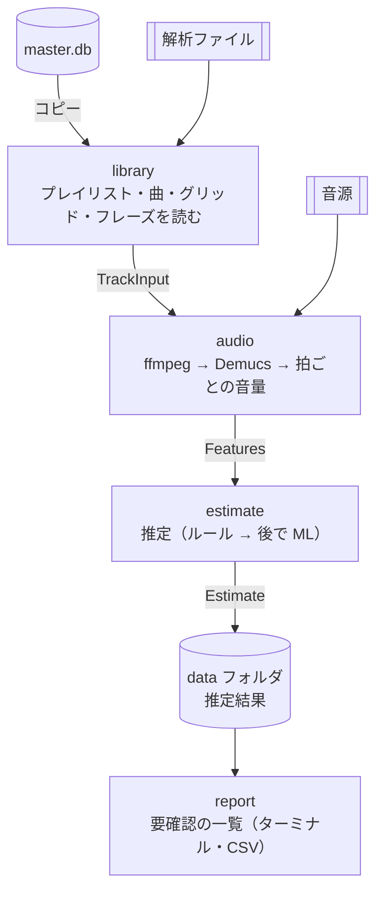
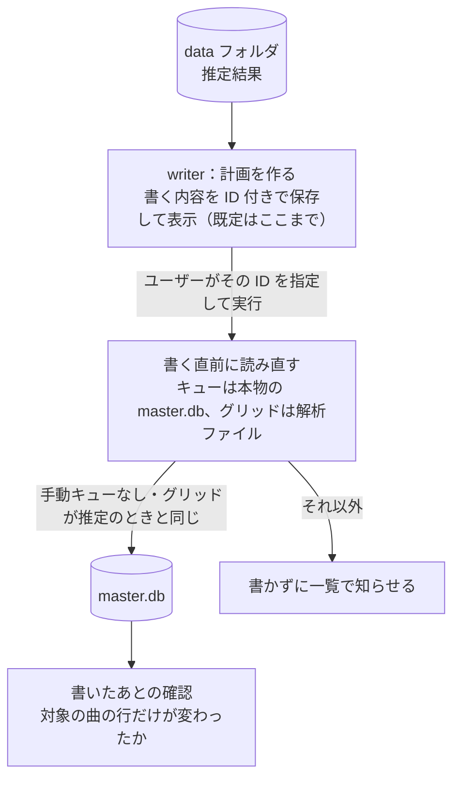
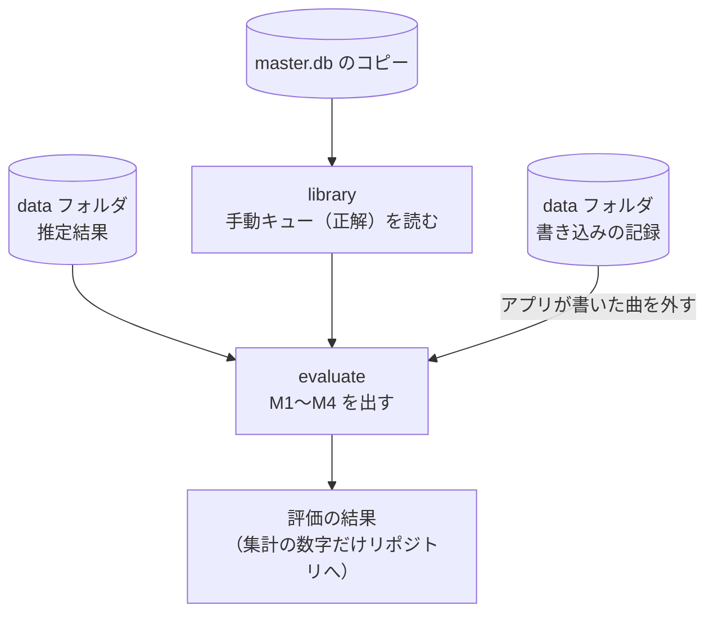

# アーキテクチャ（Phase 3）

状態：**承認**（2026-10-31、オーナー）。ここに書くのは「あとから変えにくいこと」だけ。クラスの構成、推定のルールの中身、CLI のオプションはスプリントで決める（[development-process.md](development-process.md) の Phase 3）。

前提にする決定：[ADR 0001](adr/0001-write-cues-to-master-db.md)（master.db に直接書く）、[ADR 0002](adr/0002-python-and-tooling.md)（Python 3.12・uv）、[ADR 0003](adr/0003-read-library-from-db-copy.md)（master.db のコピーと解析ファイルから読む）、[ADR 0004](adr/0004-audio-analysis-stack.md)（Rekordbox の解析 ＋ Demucs）、[requirements.md](requirements.md)。

## 1. 全体の構成図

流れは「推定」「反映」「評価」の 3 つ。1 つの図に入れると矢印が重なるので、流れごとに分けて描く。CLI（後で MCP も）はどの流れでも入り口になるだけなので、図には描かない。

**① 推定**（Rekordbox を起動したままでよい。S2〜S5）

`estimate` は `TrackInput` も受け取る（図では `audio` を通して渡している）。既存のキューは推定に渡さない（3 章）。

**② 反映**（Rekordbox と rekordboxAgent を終了してから。S6）

**③ 評価**（S1）

反映は 2 段に分ける。まず「計画を作る」で、書く内容に ID を付けて保存し、表示する。次に「その ID の計画だけを実行する」で書く。表示したあとに推定を作り直して書く、というずれを防げる。MCP から呼ぶときも、人が確かめた計画だけを書ける。

書いたあとは、バックアップと書いたあとの DB を比べる。変わったのが対象の曲の `djmdCue`・`contentCue`・`djmdContent`（`CueUpdated`・USN・更新日時）だけか、全曲で `djmdCue` の行数と `contentCue` の要素数が一致するかを確かめる。外れたら、戻す手順を案内する。

推定と反映は別のコマンドにする。推定は時間がかかるので Rekordbox を使いながら回せるようにし、反映は保存した推定結果を指定して、Rekordbox を終了してから短時間で済ませる。評価の M1〜M4 は、キューごとの的中率、全的中の曲の割合、要確認の精度と割合。

## 2. モジュールと依存の向き

| モジュール | 役割 | 外の道具 |
|---|---|---|
| `model` | モジュール間で受け渡すデータの形（3 章） | なし |
| `library` | master.db のコピーを取り、プレイリスト・曲・グリッド・フレーズを読んで `TrackInput` にする。既存のキューは別に読む | pyrekordbox |
| `audio` | 音源を読み、分離し、拍ごとの音量を出して `Features` にする | ffmpeg、Demucs、numpy |
| `estimate` | `TrackInput` と `Features` から `Estimate` を作る。ルールベースと ML を差し替えられる | numpy だけ |
| `store` | 特徴量と推定結果を data フォルダに保存し、読み出す（N9） | なし |
| `report` | 要確認の一覧をターミナルと CSV に出す | なし |
| `evaluate` | 正解を取り出し、`Estimate` と比べて M1〜M4 を出す | なし |
| `writer` | 書く計画を作り、ID を指定されたら ADR 0001 の決めごとに沿って master.db に書く。書いたあとに確かめる | pyrekordbox |
| `cli` | 上を組み合わせてコマンドにする。後で MCP サーバーも同じ組み合わせを呼ぶ | — |

**決定：依存の向き。** `estimate` と `evaluate` は `model` だけに依存し、pyrekordbox や Demucs を知らない。こうすると次の利点がある。

- 推定を差し替えても（ルール → ML）、評価と書き込みはそのまま使える（CLAUDE.md 8 章）
- `estimate`・`evaluate` のテストは、作り物のグリッドとフレーズで書ける。個人データも重い依存も要らないので、CI で回せる（決定 14）

TypeScript でいえば、`model` が共有の型定義、`library`・`audio`・`writer` が外部とのアダプター、`estimate` が純粋なドメインロジック、という分け方にあたる。

## 3. モジュール間でやりとりするデータの形

型の名前と主な中身だけ決める。細かい項目はスプリントで足す。Python では `dataclass`（TypeScript の `readonly` な型に近い）で書く。

### TrackInput（library → audio・estimate）

推定に渡す曲の情報。**既存のキューは入れない。** 評価に使う曲では既存のキューが正解の元なので、推定に渡すと、ルールや ML の特徴量に正解が紛れ込むおそれがある。型で渡せないようにしておく。「既存のキューを変えても `Estimate` が変わらない」ことを確かめるテストも CI に置く。

| 項目 | 内容 |
|---|---|
| `id` | `djmdContent.ID`。書き込みまでこの ID で曲を指す |
| `title`・`artist` | 一覧の表示用 |
| `path`・`file_type` | 音源の場所と形式（N10 の判定に使う） |
| `beats` | グリッドの拍の列。各拍は「時刻（ms）」と「小節内の拍番号（1〜4）」 |
| `phrases` | フレーズの列。各フレーズは「頭の拍の番号」と種類。曲の mood も持つ |
| `fingerprint` | 音源（パス・大きさ・更新日時）とグリッドから作る値。変わったら保存済みの結果を使わない（N9） |

### ExistingCues（library → evaluate・writer）

曲ごとの既存のキュー（種類、パッド、時刻）。`evaluate` は正解の取り出しに、`writer` は決定 11（手動キューのある曲は飛ばす）に使う。`estimate` には渡さない。

### Features（audio → estimate）

| 項目 | 内容 |
|---|---|
| `vocal_db_per_beat` | 拍ごとのボーカルの音量（dB）。`beats` と同じ長さ |
| `version` | 特徴量の作り方の版。変えたら作り直す |

### Estimate（estimate → store・report・evaluate・writer）

| 項目 | 内容 |
|---|---|
| `track_id` | `TrackInput.id` |
| `fingerprint` | 推定に使った `TrackInput.fingerprint`。書く直前に、今の音源とグリッドから作った値と比べる |
| `cues` | 推定キューの列。各キューは「種類（メモリー／ホットのパッド A〜H）」「位置」「役割のラベル」「要確認の理由（なければ空）」 |
| `track_review` | 曲全体の要確認の理由（形式が未確認、テンポが一定でない、など） |
| `estimator` | 推定の名前と版（例：`rules-v1`）。評価の記録に残す |

- **種類と位置は必ず持つ。** パッドの割り当て（2 回目のメインが A、3 回目が B…）と、同じ位置に重なったキューの処理（cueing-theory.md 3.5）は `estimate` の側で済ませる。`writer` は渡された種類と位置をそのまま書くだけにする（2026-10-31 決定）
- **役割は評価と表示のためのラベル**（増やせるコード）。MVP では `A メロの頭`、`A メロの頭の 2L 前`、`メインのホット`、`アウトロのホット H` の 4 つ。抜けのキューなどを足すときも、ラベルを増やすだけで `writer` は変えずに済む（concept.md の「オーナーのキュー打ちの方法と密結合にしない」）
- **要確認の理由**は決まった種類（コード）＋説明文にする。一覧で絞り込めるようにするため

### 位置の表し方（決定）

**推定キューの位置は「グリッドの拍の番号」で持ち、ms に直すのは書くときだけにする。**

- 拍の番号なら、必ず拍の頭に乗る。小節の 1 拍目かどうかも `beats` から分かる
- 一覧に出す小節番号も、評価で比べる小節も、拍の番号から計算する
- ms で持つと、テンポが一定でない曲や M4A の頭の無音（スパイク 4）で、グリッドとのずれが入り込む
- 書くときは、実行 1 回を 1 つのトランザクションにする（ADR 0001）
- 書く直前に解析ファイルの `PQTZ` を読み直し、`fingerprint` が推定のときと違えば（グリッドが直されていれば）、その曲は書かずに「要確認」にする（ADR 0003）。グリッドは master.db ではなく解析ファイルにあるので、DB の読み直しだけでは気づけない
- ms への変換には、書く直前に読み直したグリッドを使う

## 4. 保存するもの（N9・N12・決定 13）

すべてリポジトリの外の **data フォルダ**（既定は `~/llm/cueing-bot/data/`。環境変数で変えられる）に置く。

| もの | 単位 | 形式 | 役割 |
|---|---|---|---|
| master.db のコピー | 実行ごと | そのまま | 読み取り用（ADR 0003）。使い終わったら消す |
| 特徴量 | 曲ごと | JSON | 重い分離をやり直さずに済ませる。`fingerprint` と `version` が同じなら使い回す |
| 推定結果 | 実行ごと（中は曲ごと） | JSON | 反映するときに指定する。途中で止まっても、終わった曲を飛ばして続けられる |
| 要確認の一覧 | 実行ごと | CSV | S5。曲名入りなのでリポジトリの外 |
| 評価データ b | 曲ごと | スプリントで決める | オーナーが確かめた正解。曲名入りなのでリポジトリの外 |
| 評価の結果 | 評価ごと | JSON（集計だけリポジトリにも） | 前回と比べる（S1）。曲名入りの明細は外、集計の数字だけリポジトリに残す（D3）。推定の版に加えて、評価データの版（正解の取り出し方の版、b のファイルのハッシュ）と曲数も残す。どちらかが変わったら、前回とは比べられないと分かるようにする |
| 書く計画 | 反映ごと | JSON | ID 付き。実行するときはこの ID を指定する |
| 書き込みの記録 | 反映ごと | JSON | 実行 ID、曲の ID、書いた `djmdCue` の ID・位置・役割。評価では記録にある曲を評価データ a から外す。修正からの学習と、MVP のあとの 1 曲ずつの取り消しにも使う（requirements.md 4 章） |
| master.db のバックアップ | 書き込みごと | `master.db`・`-wal`・`-shm` と `masterPlaylists6.xml` のコピー | 直近 5 回分（N12）。取った直後にコピーを開いて確かめる（ADR 0001） |

JSON にするのは、中を目で見て確かめやすいため。拍ごとの音量は 1 曲あたり数百〜千個ほどの数で、JSON でも小さい。

## 5. テストの分け方

| 種類 | 対象 | どこで回す |
|---|---|---|
| 単体テスト | `estimate`・`evaluate`・`report`・`store`・拍と ms の変換。作り物の `Track`・`Features` を使う | CI ＋ Mac |
| 結合テスト（個人データ） | `library` で master.db のコピーを読む、`audio` で実際の曲を分離する | Mac だけ（pytest のマークで分ける） |
| 書き込みの確認 | `writer`。テスト用の曲（デモ曲のコピー）に書き、Rekordbox の画面で確かめる | Mac だけ、手で（D7） |

## 6. 決めないこと（スプリントで決める）

- クラスや関数の細かい分け方、パッケージの中のファイル構成
- 推定のルールの中身（フレーズとボーカルの音量の組み合わせ方）
- CLI のコマンド名とオプション、出力の見た目
- 評価データ b（オーナーが確認した 30 曲）のファイルの形
- MCP サーバーの形（Sprint 4 以降）
